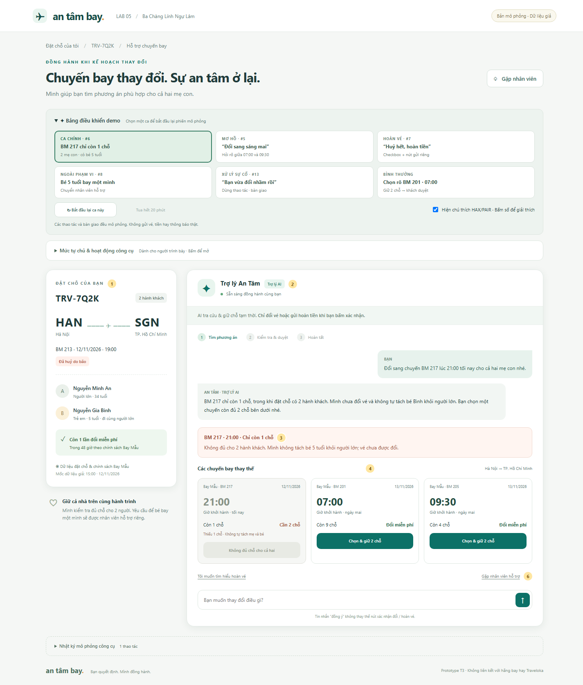
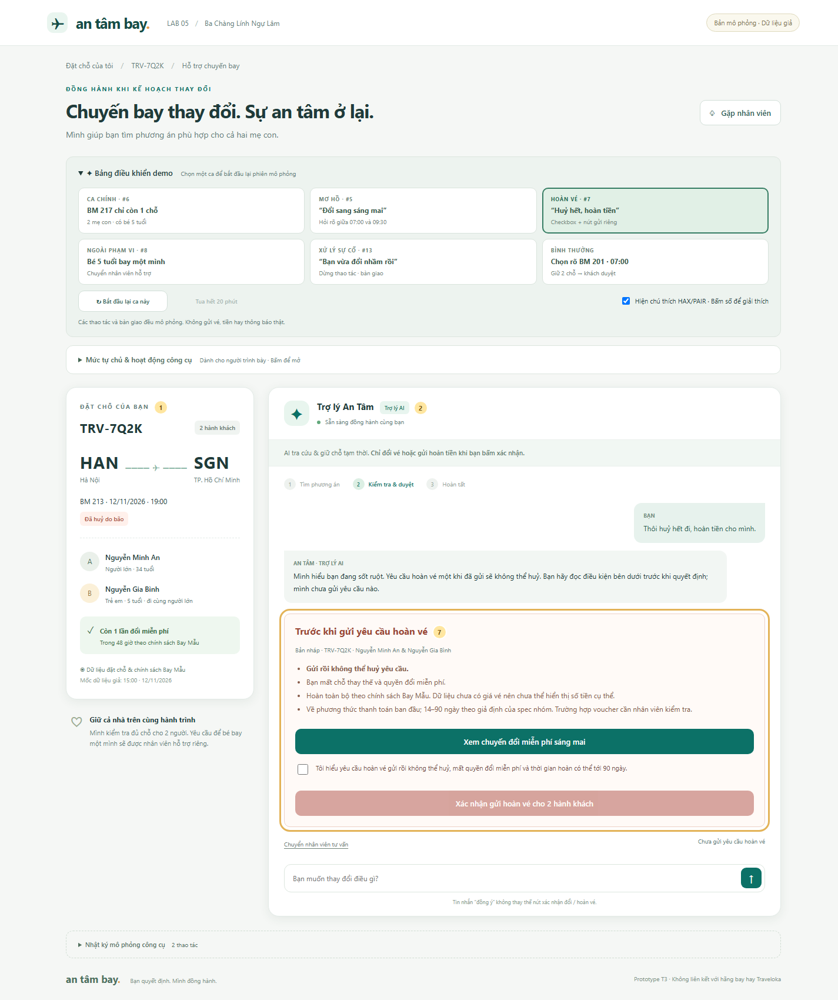

# An tâm bay — Prototype chặng 5

Mở **`index.html`** bằng Chrome hoặc Edge. Không cần cài đặt, đăng nhập, API key, mạng hoặc server. CSS/JavaScript được lưu cùng thư mục; giữ nguyên các file khi chia sẻ.

Đây là prototype mô phỏng bằng HTML/CSS/JavaScript, không gọi AI thật hoặc hệ thống hãng bay. Hội thoại dùng các nhánh từ khoá, không phải chatbot hiểu mọi cách diễn đạt. Tải lại trang sẽ bắt đầu lại; không lưu thông tin ra ngoài.

## Demo chính — khoảng 3 phút

1. Mở trang: tình huống mặc định là **BM 217 lúc 21:00 cho cả hai mẹ con**. Chỉ rõ đặt chỗ có bé 5 tuổi, chuyến chỉ còn 1 chỗ và AI không tự tách hành khách.
2. Bấm **Chọn & giữ 2 chỗ** trên BM 205 lúc 09:30. Chỉ đồng hồ 20 phút và dòng **Chưa đổi vé**. AI được tự giữ chỗ, chưa được tự đổi.
3. Bấm **Thử nhắn: “Ừ, đổi đi”**. Vé vẫn chưa đổi; phải bấm nút xác nhận có tên chuyến, giờ và 2 khách.
4. Bấm **Xác nhận đổi BM 205**. Kết quả ghi rõ cả hai hành khách và lần đổi miễn phí đã dùng.
5. Mở **Nhật ký mô phỏng công cụ** để chỉ thứ tự: tra cứu → giữ chỗ → tra cứu lại → đổi sau duyệt.
6. Có thể bấm **Thử ca: “Bạn vừa đổi nhầm rồi”** để xem dừng tự động và bàn giao; không có lời hứa hoàn tác không có căn cứ.

## Các nhánh demo bổ sung

- **Chọn ca bằng thẻ:** bảng điều khiển phía trên có 6 thẻ tình huống, thẻ đang chọn được tô màu và có trạng thái nhấn. Mỗi lần chọn thẻ sẽ bắt đầu lại phiên mô phỏng.
- **#5 — Đổi sang sáng mai:** chọn thẻ tương ứng; không tự chọn chuyến. BM 217 vẫn hiện nhưng bị khoá với lý do thiếu 1 chỗ; hai phương án hợp lệ để khách quyết định. Ca này là kiểm tra bổ sung; ca chính khác mẫu giảng viên.
- **#7 — Hoàn tiền:** nút gửi mặc định bị khoá. Gõ “Có” hoặc “Đồng ý” không gửi yêu cầu. Tích checkbox cũng chưa gửi; chỉ bấm nút gửi sau đó mới tạo kết quả mô phỏng. Có nút quay lại đổi chuyến.
- **Hết hạn giữ:** sau khi giữ chỗ, bấm **Hết 20 phút** để tua thời gian mô phỏng; nút đổi biến mất. Kiểm tra lại rồi chọn lại mới giữ chỗ mới.
- **Trẻ bay một mình:** chọn tình huống #8; chuyển nhân viên, không có nút tự đổi cho trẻ.
- **Chọn rõ chuyến:** tình huống bình thường tự giữ BM 201, vẫn cần duyệt để đổi.
- **Bắt đầu lại:** xoá trạng thái phiên mô phỏng, không phải thao tác hoàn tác giao dịch thật.

## Ảnh chú thích HAX/PAIR

Bật **Hiện chú thích HAX/PAIR**, rồi bấm số trên màn hình để mở phần giải thích và làm nổi bật vùng tương ứng. Nút có thể dùng bằng bàn phím; đóng bằng nút ✕ hoặc Escape để trở lại vị trí đã bấm. Mở giải thích không đổi vé, gửi hoàn hay đặt lại hạn giữ chỗ.

Mở **Mức tự chủ & hoạt động công cụ** để xem bảng các tool, điều kiện và trạng thái: **Vừa mô phỏng** là thao tác mới nhất trong log; **Chờ khách duyệt** là thao tác chưa chạy. Bảng gồm 5 tool gốc và 2 tool tách/bổ sung được ghi rõ. Đây là bảng giải thích dành cho người demo, không thay đổi chính sách tự chủ của nhóm.

Các số trên màn hình và ảnh:

| Số | Chỗ trên giao diện | Nguyên tắc / mức tự chủ |
|---|---|---|
| 1 | Đặt chỗ, số hành khách, tuổi, dữ liệu nguồn | PAIR Explainability & Trust; tra cứu tự làm |
| 2 | Badge AI và giới hạn khả năng | HAX G1; nêu rõ đổi/hoàn cần duyệt |
| 3 | BM 217 chỉ còn 1 chỗ, không đủ cho cả hai | PAIR Explainability; không thực hiện phương án không hợp lệ |
| 4 | Hai phương án sáng hôm sau, số chỗ, nút chọn riêng | HAX G10; hỏi rõ thay vì đoán |
| 5 | Giữ 20 phút, chưa đổi; thẻ duyệt với cảnh báo quyền lợi | PAIR Trust; giữ chỗ tự làm, đổi vé khách duyệt |
| 6 | Huỷ giữ chỗ / chọn lại / gặp nhân viên | HAX G8/G9, PAIR Graceful Failure; đường lui trước giao dịch |
| 7 | Cảnh báo hoàn, checkbox, nút gửi bị khoá, nút quay lại | PAIR Graceful Failure; hoàn vé cần duyệt nghiêm ngặt |





## Phạm vi mô phỏng và quyết định thiết kế

- **Giữ chỗ / đổi / hoàn / bàn giao** chỉ thay đổi trạng thái trong trang. Kết quả thành công là giả lập, không phải xác nhận của hãng.
- **Nguồn sự thật:** fixture T3, mốc 15:00 ngày 12/11/2026. Không có sơ đồ ghế, giờ đến hoặc giá vé nên không hứa ngồi cạnh nhau, tới nơi đúng giờ hoặc bịa số tiền hoàn.
- **Thời gian hoàn 14–90 ngày** kế thừa giả định của spec nhóm; không phải dữ liệu thời gian tối thiểu được cấp trong fixture. Trang không xác minh chính sách hãng thật.
- **Tool bổ sung `huy_giu_cho`:** mô phỏng nhả chỗ trước hạn khi khách huỷ/chọn lại hoặc chuyển nhân viên. Tool gốc chỉ bảo đảm tự nhả sau 20 phút; đây là mở rộng cần nhóm ghi nhận khi hoàn thiện §4. Không áp dụng cho vé đã đổi hoặc yêu cầu hoàn đã gửi.
- **Chọn thẻ thông tin thay vì phần trăm chắc chắn:** khách kiểm tra trực tiếp số chỗ, ngày giờ và hành khách; không có dữ liệu để tính một tỷ lệ tin cậy.
- **Chọn xác nhận trên thẻ thay cho chat:** hạn chế nhầm “ừ” với đồng ý thực hiện thao tác khó đảo ngược.
- **Chọn màu xanh cho phương án đổi, màu cam/đỏ cho rủi ro:** đi kèm câu chữ rõ ràng, không dùng màu làm dấu hiệu duy nhất.
- **Bàn giao:** tạo ngay bản tóm tắt mô phỏng gồm lý do, PNR, hội thoại và trạng thái; không cam kết nhân viên thật đã nhận hoặc thời gian xử lý.

## Kiểm tra

```text
node prototype/verify.cjs
python prototype/verify-browser.py
```

Chạy từ thư mục gốc repo. Kiểm tra Node không cần thư viện ngoài. Kiểm tra trình duyệt cần Python có `websockets` và Chrome cài sẵn (hoặc đặt `CHROME_PATH`); người xem demo không cần chúng.

Đã kiểm tra 8 nhóm logic: thiếu chỗ; xác nhận mơ hồ; hết hạn; checkbox và nút gửi; quay lại xoá đồng thuận; trẻ bay một mình; chống đổi trùng; không đổi tự động sau hoàn. Kiểm tra thêm trên Chrome bằng thao tác DOM, không phát hiện lỗi JavaScript; 4 trạng thái ở chiều rộng 390px không tràn ngang. Ảnh được chụp từ trình duyệt thật.

Giới hạn: chưa kiểm tra với hệ thống hãng thật, AI thật, trình đọc màn hình hoặc mọi trình duyệt. Dữ liệu chỗ trống là fixture cố định; nút kiểm tra lại không truy vấn kho vé trực tuyến.
